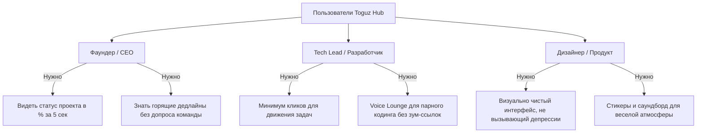

# 🎯 01. Видение продукта и Границы проекта (Scope)

## 1. Контекст и Проблема
Стартап-команды (3–25 человек) работают в режиме высокой неопределенности и стремительных итераций. Традиционные Enterprise-решения (Bitrix24, Jira, SAP) перегружены бюрократией:
* Они созданы для корпораций с раздутыми отделами контроля, где за каждой задачей следит проджект-менеджер и юрист.
* Разработчики и фаундеры тратят по 30 минут в день на бессмысленное заполнение чек-листов и отчетов.
* Коммуникация разрывается: задачи живут в одном месте (Jira/Bitrix), созвоны в Google Meet/Zoom, а живое общение — в Telegram или Discord.

## 2. Ключевая концепция
**Toguz Hub** объединяет трекинг разработки и живой социальный хаб в одном стильном окне:
1. **Прозрачность и контроль**: Фаундер открывает титульный экран и за 3 секунды понимает общее состояние продукта (какие модули готовы на сколько процентов, и что нужно тушить прямо сейчас).
2. **Драйв и командный дух**: Разработчики не чувствуют себя винтиками корпоративной машины. Присутствует атмосфера виртуального опенспейса: всегда можно «завалиться» в голосовую комнату к коллеге, запустить звук на саундборде в честь успешного релиза или скинуть мемный стикер в тред задачи.
3. **Фокус на главном**: Никаких складов, бухгалтерских проводок, громоздких CRM-воронок. Только **Проекты**, **Модули**, **Задачи**, **Чаты** и **Голосовые комнаты**.

---

## 3. Целевые персоны (Target Personas)

### Персона 1: Алекс (24 года, Solo/Co-Founder стартапа)
* **Боли**: В Битриксе тонет в уведомлениях. В Trello не хватает структуры и модульности. В Slack/Discord теряются дедлайны.
* **Цель**: Зайти с утра с кофе, глянуть на титульную страницу: Проект X готов на 68%, модуль "Auth" — 100%, модуль "Stripe" — 45%, горят 2 задачи. Все кристально ясно.

### Персона 2: Данияр (22 года, Full-stack разработчик)
* **Боли**: Ненавидит заполнять 15 обязательных полей в Битрикс/Jira. Раздражают бесконечные созвоны, на которые надо планировать слоты в календаре.
* **Цель**: Зайти в голосовой канал "Dev Room", включить экран, покодить вместе с тиммейтом, закрыть задачу, нажать на саундборде победный звук "Victory" и пойти обедать.

---

## 4. Границы проекта (MVP Scope vs Future)

### Входит в MVP (Core Scope)
1. **Title Dashboard**:
   - Список проектов с прогресс-барами.
   - Декомпозиция проекта на Модули с индивидуальным % завершения.
   - Секция «🔥 Burning Tasks» (задачи с дедлайном < 24ч или просроченные).
2. **Канбан-доска**:
   - Колонки: Backlog, In Progress, Review, Done.
   - Автоматическая смена цвета карточки в зависимости от времени до дедлайна.
   - Быстрое создание задач (Enter для следующей, никаких 10 полей).
3. **Модульные чаты**:
   - Привязка текстового канала к каждому модулю.
   - Поддержка Markdown, сниппетов кода, загрузки картинок.
4. **Discord-подобный Voice Lounge**:
   - Постоянные аудиокомнаты (до 10 участников на комнату в MVP).
   - Индикация говорящего (зеленый ободок вокруг аватара).
   - Быстрый Mute / Deafen горячими клавишами.
5. **Саундборд & Стикеры**:
   - Сетка из 12-16 звуковых кнопок (Soundboard) с трансляцией в голосовую комнату.
   - Паки кастомных стикеров и реакций для сообщений.

### НЕ входит в проект (Строго исключено)
- CRM-сделки, холодные звонки, интеграции с телефонией АТС.
- Складской учет, остатки товаров на складе, номенклатура.
- Генераторы бухгалтерских актов, счетов-фактур, договоров.
- Сложные матрицы прав доступа (где 70 ролей и 500 галочек прав).

---

Связанные разделы:
- [[02_Project_&_Module_Hierarchy|02. Иерархия проектов и модулей]]
- [[08_The_Anti_Bitrix_Blacklist|08. Черный список фичей Анти-Битрикс]]
- [[03_Technical_Architecture/Architecture_Overview|Архитектура системы]]
