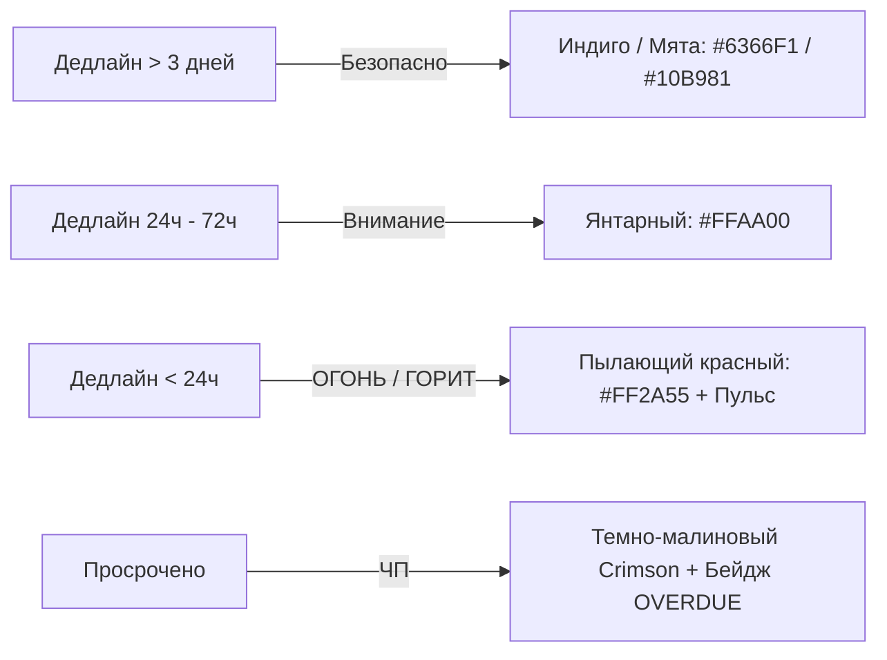

# 📋 04. Канбан-доска и Цветовая шкала дедлайнов

Канбан в Toguz Hub спроектирован по принципу: **«Ничего лишнего, максимальная скорость и визуальная ясность»**.

---

## 1. Отличие от Битрикс24

| Фича | Битрикс24 | Toguz Hub (Наш подход) |
| :--- | :--- | :--- |
| **Создание задачи** | 12 обязательных полей, выбор соисполнителей, аудиторов, связка со сделкой | **1 поле ввода** (нажал `Enter` — задача создана) |
| **Отображение дедлайнов** | Мелкий серый текст `29.10 18:00` | **Яркий динамический цветовой глоу**: от спокойного индиго до пылающего неонового красного |
| **Колонки** | Жестко заданные сложные стадии с автоматическими роботами | 4 чистые стадии: `Backlog` → `In Progress` → `Review` → `Done` |
| **Празднование закрытия** | Никаких эмоций (просто перенос в список) | Конфетти, тактильный щелчок и возможность пустить звук на саундборд |

---

## 2. Цветовая градация дедлайнов (Color-Coded Deadline Engine)

Время до дедлайна вычисляется в реальном времени: $\Delta t = T_{\text{due}} - T_{\text{now}}$.



### Спецификация состояний карточки:

1. 🟢 **Safe / Normal ($\Delta t > 72$ часа или дедлайн не задан)**:
   * Граница карточки: нейтральная темная `#2A2D37`.
   * Бейдж дедлайна: аккуратный серый или мятный `#10B981` (например, `📅 5 Nov`).
2. 🟡 **Approaching / Warning ($24 \le \Delta t \le 72$ часа)**:
   * Граница карточки: янтарно-желтая `#FFAA00`.
   * Бейдж дедлайна: золотистый фон с черным текстом (`⏳ 2d left`).
3. 🔴 **Burning / Critical ($\Delta t < 24$ часа)**:
   * **Цвет**: Неоновый пылающий красный `#FF2A55`.
   * **Свечение**: Неоновая тень `box-shadow: 0 0 14px rgba(255, 42, 85, 0.45)`.
   * **Таймер**: `🔥 4h 12m left` с обратным отсчетом.
   * **Анимация**: Мягкая циклическая пульсация рамки карточки (1.5 сек интервал).
4. 💀 **Overdue ($\Delta t < 0$)**:
   * Малиново-бордовый сплошной бейдж `⚠️ EXPIRED by 2h`.
   * Автоматически поднимается на самый верх колонки для привлечения внимания.

---

## 3. Анатомия Канбан-карточки (Card Anatomy)

```
+-------------------------------------------------------------+
| [🔴 3h left 🔥]                       [Module: WebRTC SFU]  |
|                                                             |
| Реализовать авто-реконнект при обрыве WebRTC сессии         |
|                                                             |
| 💬 4 comments   📎 1 log.txt                                |
|-------------------------------------------------------------|
| Priority: [High]               Assignee: [@dastan (Avatar)] |
+-------------------------------------------------------------+
```

### Свойства задачи (Только необходимый минимум!):
* **Title (Название)**: Обязательное, до 150 символов.
* **Module (Модуль)**: К какому модулю относится задача (например, `Voice`, `Auth`, `Billing`).
* **Due Date (Дедлайн)**: Дата и точное время (для расчета цвета).
* **Assignee (Исполнитель)**: 1 человек (в стартапах один ответственный, никаких 5 соисполнителей, размывающих ответственность).
* **Description (Описание)**: Легкий Markdown (чек-листы, код, ссылки).
* **Checklist (Чек-лист подзадач)**: Чекбоксы, которые показывают прогресс выполнения `3/5`.

---

## 4. Колонки доски

1. **Backlog (В планах)**: Задачи, которые предстоит взять в спринт.
2. **In Progress (В работе)**: Задачи, над которыми сейчас физически работают. Рекомендуемый лимит WIP (Work In Progress) — не более 3 задач на человека.
3. **Review / QA (На проверке)**: Код отправлен в Pull Request или дизайн на утверждении.
4. **Done (Сделано)**: Завершенные задачи. При перемещении сюда:
   * Карточка теряет красный цвет (даже если дедлайн прошел, задача теперь завершена!).
   * Запускается праздничная микро-анимация.
   * Пересчитывается процент выполнения модуля на [[03_Dashboard_&_Title_Page|Главной странице]].

---

## 5. Быстрый ввод задач (Speed-run UX)
* Нажатие клавиши `N` (или кнопка `+ New Task` внизу колонки): открывает инлайн-инпут.
* Синтаксис авто-тегов прямо в строке ввода:
  - `Fix audio bug @dastan ^Voice !tomorrow`
  - Автоматически назначит исполнителя `@dastan`, модуль `Voice` и дедлайн `tomorrow`.

Смотрите далее:
- [[02_Project_&_Module_Hierarchy|02. Расчет прогресса модулей]]
- [[07_Soundboards_&_Stickers|07. Звуковые триггеры при завершении задач]]
- [[02_UX_UI_Design_System/Color_Palette_&_Deadline_Hues|Цветовая палитра дедлайнов]]
