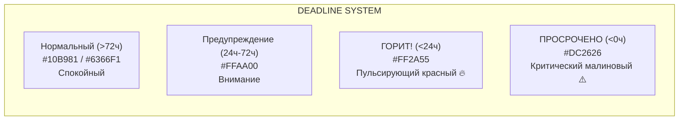

# 🎨 Цветовая палитра и Горящие дедлайны

Цветовая система Toguz Hub разделена на две части: базовые интерфейсные токены темной темы и **динамическую спектральную шкалу срочности дедлайнов**.

---

## 1. Базовые системные цвета (UI Foundation)

| Токен | HEX | Назначение |
| :--- | :--- | :--- |
| `bg-primary` | `#0B0D13` | Самый глубокий фоновый цвет холста приложения |
| `bg-surface-1` | `#131620` | Фоновый цвет карточек, сайдбара и модальных окон |
| `bg-surface-2` | `#1B1F2D` | Ховер-состояния карточек, фон полей ввода |
| `border-subtle` | `rgba(255, 255, 255, 0.08)` | Стандартные тонкие границы блоков |
| `text-primary` | `#F3F4F6` | Основной читаемый текст заголовков и задач |
| `text-secondary` | `#9CA3AF` | Вспомогательный текст (метки, даты, авторы) |
| `text-muted` | `#6B7280` | Неактивные подсказки и хоткеи |
| `accent-discord` | `#5865F2` | Брендовый акцент Discord: активные каналы, кнопки звонка |
| `accent-emerald` | `#10B981` | Успех, статус Done, говорящий микрофон |

---

## 2. Спектральная шкала дедлайнов (The Burning Deadline System)

Каждая задача и модуль динамически получают цветовую тему в зависимости от времени до сдачи:



### Детальная спецификация состояний:

#### 1. 🔥 Burning Red (`#FF2A55`) — «Дедлайн горит»
* **Критерий**: До дедлайна осталось менее 24 часов ($0 \le \Delta t \le 24$h).
* **CSS токены**:
  ```css
  --deadline-burning-color: #FF2A55;
  --deadline-burning-bg: rgba(255, 42, 85, 0.12);
  --deadline-burning-border: rgba(255, 42, 85, 0.6);
  --deadline-burning-glow: 0 0 16px rgba(255, 42, 85, 0.4);
  ```
* **Поведение**:
  - Карточка на канбан-доске подсвечивается неоновой красной рамкой.
  - На карточке отображается анимированный огонек `🔥` и моноширинный таймер обратного отсчета: `🔥 05h 42m`.
  - Модуль, содержащий данную задачу, помечается красным бейджем на [[03_Dashboard_&_Title_Page|Главной странице]].

#### 2. ⏳ Warning Amber (`#FFAA00`) — «Обрати внимание»
* **Критерий**: До дедлайна осталось от 24 до 72 часов ($24\text{h} < \Delta t \le 72\text{h}$).
* **CSS токены**:
  ```css
  --deadline-warning-color: #FFAA00;
  --deadline-warning-bg: rgba(255, 170, 0, 0.10);
  --deadline-warning-border: rgba(255, 170, 0, 0.45);
  ```
* **Поведение**: Теплый янтарный бейдж `⏳ 2d left`, призывающий команду взять задачу в фокус.

#### 3. 🌿 Safe Indigo/Mint (`#6366F1` / `#10B981`) — «Все спокойно»
* **Критерий**: До дедлайна более 3 дней ($\Delta t > 72\text{h}$) или дедлайн не назначен.
* **Поведение**: Карточка сливается со спокойной темной темой, не вызывая тревожности и когнитивного стресса.

#### 4. 💀 Overdue Crimson (`#DC2626`) — «Просрочено»
* **Критерий**: $\Delta t < 0$ (время дедлайна прошло, задача еще не в колонке `DONE`).
* **Поведение**: Сплошной залитый бейдж `⚠️ EXPIRED by 3h`, задача автоматически сортируется наверх списка.

---

## 3. Цветовые градиенты прогресса модулей (% Progress Rings)

Для визуализации завершенности модулей используются градиенты:

```css
/* Модуль в самом начале пути (0% - 30%) */
--gradient-module-early: linear-gradient(135deg, #FF2A55 0%, #FF708F 100%);

/* Модуль в активной фазе (31% - 75%) */
--gradient-module-mid: linear-gradient(135deg, #FFAA00 0%, #8B5CF6 100%);

/* Модуль на финишной прямой (76% - 99%) */
--gradient-module-final: linear-gradient(135deg, #6366F1 0%, #06B6D4 100%);

/* Модуль завершен (100% DONE) */
--gradient-module-complete: linear-gradient(135deg, #10B981 0%, #34D399 100%);
```

Смотрите далее:
- [[Component_Library_Specs|Спецификация компонентов]]
- [[04_Kanban_&_Task_Management|Канбан-доска и Задачи]]
- [[03_Dashboard_&_Title_Page|Главная страница]]
