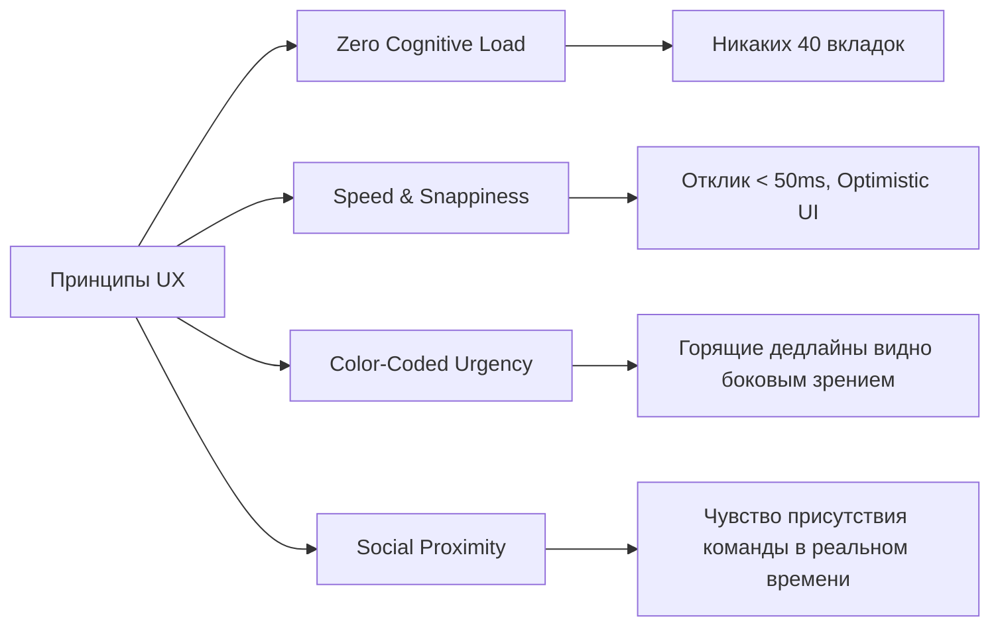

# 🎨 Дизайн-принципы и Эстетика: Discord x Linear

## 1. ДНК Дизайна (Design DNA)
Интерфейс Toguz Hub сочетает в себе **строгую функциональную чистоту Linear** с **живой, ламповой и игровой эстетикой Discord**:

* **Dark Mode First**: 95% разработчиков и дизайнеров стартапов работают в темной теме. Основной фон — глубокий нейтральный темный (`#0D0F14` и `#141721`), без синевы дешевого пластика и без утомляющего абсолютно черного `#000000`.
* **Glassmorphism & Depth**: Карточки проектов и модулей имеют полупрозрачные фоны с эффектом размытия (`backdrop-filter: blur(16px)`), тонкими неоновыми обводками (`border: 1px solid rgba(255, 255, 255, 0.08)`).
* **Сфокусированная типографика**: Четкие гротески без засечек: `Geist`, `Inter` или `Plus Jakarta Sans`. Числа и таймеры дедлайнов — строго моноширинные (`JetBrains Mono` или `Geist Mono`), чтобы цифры обратного отсчета не прыгали по ширине.
* **Микро-интерактивность**: Каждый клик дает отклик: мягкое увеличение кнопки при наведении (`scale: 1.02`), упругий drag-and-drop карточек (spring animations через Framer Motion), мгновенные звуковые клики.

---

## 2. Ключевые принципы взаимодействия (UX Commandments)

### 1. Zero Cognitive Load (Нулевой визуальный шум)
* В Битриксе интерфейс переполнен мелкими ссылками, кнопками «Еще...» и выпадающими меню.
* У нас действует **правило 3 слоев**:
  1. *Первый слой (на виду)*: Проекты, Модули с %, Горящие дедлайны, Активные голосовые комнаты.
  2. *Второй слой (1 клик)*: Задачи конкретного модуля на Канбане, Чат модуля.
  3. *Третий слой (модалка / сайд-панель)*: Полное описание задачи, логи, история изменений.

### 2. Optimistic UI (Мгновенный отклик интерфейса)
* При перемещении задачи из `In Progress` в `Done` карточка перемещается мгновенно (0мс), а запрос на сервер отправляется в фоне.
* Если произошла ошибка сети — карточка плавно возвращается назад с уведомлением (Toast). Пользователь никогда не должен видеть спиннер загрузки при обычном перетаскивании.

### 3. Visual Urgency (Визуальная градация срочности)
* Человеческий мозг моментально считывает цвет.
* Горящая задача должна привлекать внимание даже периферийным зрением: яркое свечение красного спектра (`#FF2A55`), бейдж с огоньком `🔥` и таймер.
* Задачи без спешки не кричат о себе и оформлены в спокойных матовых тонах.

---

## 3. Сетка и отзывчивость (Layout & Grid)
* **Desktop-first**: Основная среда для стартапа — монитор 1440px+ (MacBook, PC).
* **Трехколоночная структура**:
  - `Левая панель (240px)`: Переключатель воркспейсов, список проектов, голосовые комнаты.
  - `Центральная область (Fluid)`: Главный дашборд / Канбан-доска / Чат.
  - `Правая панель (Collapsible, 320px)`: Саундборд, инспектор задачи или активный звонок.

Смотрите далее:
- [[Color_Palette_&_Deadline_Hues|Цветовая палитра и токены]]
- [[Component_Library_Specs|Спецификация компонентов]]
- [[Sound_&_Haptic_Design|Звуковой дизайн]]
