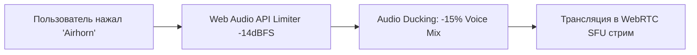

# 🔊 Звуковой и Тактильный дизайн (Audio/Haptic Guidelines)

В Toguz Hub звук играет ключевую роль: он превращает монотонную работу за компьютером в динамичный и живой опыт, вдохновленный консольными играми и Discord.

---

## 1. Системные звуковые триггеры (UI Sound Effects)

Все системные звуки должны быть ультра-короткими (от 40 до 250 мс), нераздражающими и с мягким спадом частот (Low-pass filter):

| Действие | Звуковой сэмпл | Характеристика звука |
| :--- | :--- | :--- |
| **Move Task to Done** | `task_shipped.mp3` (120ms) | Приятный звонкий щелчок («Pop & Ding») с легким реверберационным хвостом |
| **Task Created (Enter)** | `task_create.mp3` (60ms) | Мягкий упругий клик (как нажатие премиального свитча клавиатуры) |
| **New Urgent Burning Task** | `alarm_pulse.mp3` (200ms) | Низкий кинематографический «sub-bass thud» без визгливых сирен |
| **Connect to Voice Room** | `voice_join.mp3` (150ms) | Гармоничный двутональный восходящий сигнал (Chord Up) |
| **Disconnect from Voice** | `voice_leave.mp3` (120ms) | Двутональный нисходящий сигнал (Chord Down) |
| **Mute / Unmute Mic** | `mic_toggle.mp3` (40ms) | Глухой щелчок механического тумблера |

---

## 2. Архитектура громкости Саундборда и Авто-даккинг (Audio Ducking)

Когда кто-то из команды нажимает кнопку на [[07_Soundboards_&_Stickers|Саундборде]], звук не должен глушить собеседников до боли в ушах.

### Алгоритм авто-даккинга:
1. При запуске сэмпла саундборда голосовой поток других участников **НЕ глушится**, но громкость микрофона говорящего временно понижается на **15%** (Gain: 0.85).
2. Максимальный пик саундборда жестко ограничен программным компрессором/лимитером (Dynamic Range Limiter) на отметке `-14 dBFS`.
3. По умолчанию в микшере саундборд играет на громкости **65%**, чтобы человеческая речь всегда оставалась в приоритете.

---

## 3. Настройки приватности и комфорта (User Controls)
Не все любят громкие звуки во время глубокой концентрации. В настройках пользователя предусмотрены:
* `Master SFX Volume` (0% - 100%).
* `Disable All Soundboard Sounds` (чекбокс «Режим максимальной концентрации»).
* `Mute App Sounds when Screen Sharing` (автоматическое заглушение уведомлений во время демонстрации экрана).

Смотрите далее:
- [[07_Soundboards_&_Stickers|07. Саундборд и Стикеры]]
- [[03_Technical_Architecture/Soundboard_Media_Pipeline|Пайплайн воспроизведения аудио]]
