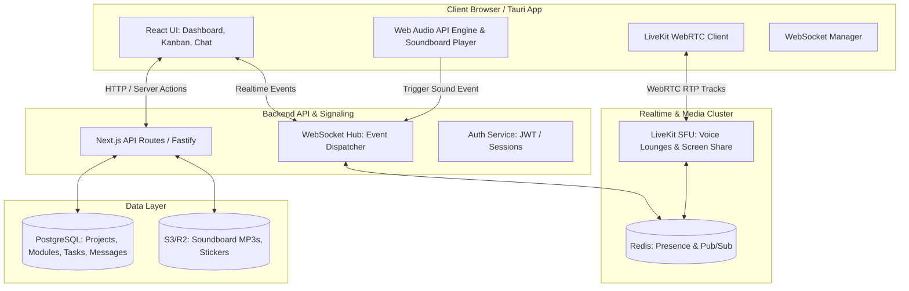

# 🛠️ 01. Обзор технической архитектуры

Архитектура Toguz Hub спроектирована с прицелом на **сверхнизкую задержку (Sub-second latency)**, мгновенную синхронизацию состояния и высокую надежность голосового общения.

---

## 1. Стек технологий (Recommended Modern Tech Stack)

| Слой | Технология | Обоснование выбора |
| :--- | :--- | :--- |
| **Frontend Framework** | **Next.js 15 (App Router) / React 19** | SSR для мгновенного FCP, Server Actions, нативный React Server Components |
| **Desktop Wrapper (Опц.)** | **Tauri 2.0 (Rust)** | Легковесный нативный клиент (< 15MB RAM против 500MB у Electron), глобальные хоткеи |
| **Styling & UI** | **Tailwind CSS + Radix UI + Framer Motion** | Молниеносная верстка, доступность (a11y), 60 FPS spring animations |
| **Database** | **PostgreSQL 16** | Реляционная надежность, поддержка JSONB, транзакционность при пересчете модулей |
| **ORM / Query Builder** | **Prisma** или **Drizzle ORM** | Type-safe схемы, автогенерация TypeScript типов |
| **Realtime Signaling** | **WebSockets (Socket.io / ws) + Redis Pub/Sub** | Мгновенный бродкаст перемещения задач и статусов участников |
| **Voice / Video Engine** | **LiveKit (WebRTC SFU)** или **mediasoup** | Discord-подобная масштабируемость голоса, авто-балансировка битрейта, готовые SDK |
| **Object Storage** | **Cloudflare R2 / AWS S3** | Хранение аудиофайлов саундборда, стикеров и аватарок с CDN кэшированием |

---

## 2. Диаграмма взаимодействия компонентов (Component Architecture)

---

## 3. Ключевые потоки данных (Data Flows)

### А. Синхронизация Канбана и Прогресса Модулей
1. Пользователь перетаскивает карточку в `DONE`.
2. Frontend мгновенно применяет **Optimistic Update** (карточка прыгает в Done, локальный счетчик % пересчитывается).
3. Клиент отправляет WebSocket-событие `task:moved`.
4. Сервер в транзакции:
   - Обновляет статус задачи в PostgreSQL.
   - Вызывает функцию `recalculateModuleProgress(moduleId)`.
   - Если прогресс изменился — эмитит событие `module:progress_updated` всем участникам воркспейса.
5. Если задача была горящей (`BURNING`), она автоматически удаляется из глобального баннера тревог на титульной странице.

### Б. Стриминг звука Саундборда
1. Пользователь кликает кнопку «Airhorn» на саундборде.
2. Фронтенд отправляет WS-пакет: `{ event: 'soundboard:play', soundId: 'airhorn-1', roomId: 'dev-lounge' }`.
3. Сервер валидирует кулдаун (не чаще 1 раза в 3 сек).
4. Сервер рассылает сигнал всем клиентам в комнате `roomId`.
5. Каждый клиент локально через **Web Audio API** мгновенно воспроизводит кэшированный сэмпл со своего диска/буфера с авто-даккингом громкости микрофонов.
*(Примечание: такой подход экономит колоссальный серверный трафик по сравнению со смешиванием аудио на стороне SFU!)*

Смотрите далее:
- [[Database_Schema_&_Data_Models|Схема БД и моделей]]
- [[Realtime_Sync_&_WebSockets|Спецификация WebSocket событий]]
- [[WebRTC_&_Voice_Engine|WebRTC и Голосовой движок]]
