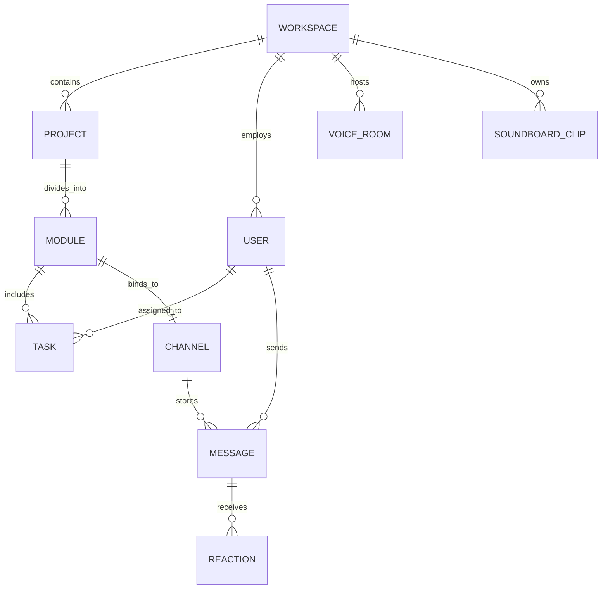

# 🗄️ 02. Схема БД и Модели данных

Ниже представлена эталонная схема базы данных на базе **PostgreSQL** в синтаксисе **Prisma ORM**.

---

## 1. ER-диаграмма сущностей



---

## 2. Полный Prisma Schema файл (`schema.prisma`)

```prisma
datasource db {
  provider = "postgresql"
  url      = env("DATABASE_URL")
}

generator client {
  provider = "prisma-client-js"
}

// -------------------------------------------------------------
// 1. Организации и Пользователи
// -------------------------------------------------------------

enum UserRole {
  OWNER      // Фаундер: полный доступ к удалению воркспейса
  CORE       // Тимлид / Ключевой разраб: создание проектов и модулей
  MEMBER     // Участник: создание и перемещение задач, чаты, голос
  GUEST      // Гость / Подрядчик: просмотр назначенных задач
}

model User {
  id            String    @id @default(cuid())
  email         String    @unique
  name          String
  avatarUrl     String?
  role          UserRole  @default(MEMBER)
  workspaceId   String
  workspace     Workspace @relation(fields: [workspaceId], references: [id], onDelete: Cascade)
  
  assignedTasks Task[]    @relation("TaskAssignee")
  ledModules    Module[]  @relation("ModuleLead")
  messages      Message[]
  reactions     Reaction[]
  
  createdAt     DateTime  @default(now())
  updatedAt     DateTime  @updatedAt

  @@index([workspaceId])
}

model Workspace {
  id              String            @id @default(cuid())
  name            String
  slug            String            @unique
  projects        Project[]
  users           User[]
  voiceRooms      VoiceRoom[]
  soundboardClips SoundboardClip[]
  stickerPacks    StickerPack[]
  
  createdAt       DateTime          @default(now())
}

// -------------------------------------------------------------
// 2. Иерархия: Проекты -> Модули -> Задачи
// -------------------------------------------------------------

model Project {
  id          String    @id @default(cuid())
  name        String
  description String?
  workspaceId String
  workspace   Workspace @relation(fields: [workspaceId], references: [id], onDelete: Cascade)
  modules     Module[]
  
  cachedProgress Int     @default(0) // Кэшированный % завершенности (0-100)
  
  createdAt   DateTime  @default(now())
  updatedAt   DateTime  @updatedAt

  @@index([workspaceId])
}

model Module {
  id              String    @id @default(cuid())
  name            String
  description     String?
  icon            String    @default("box")
  projectId       String
  project         Project   @relation(fields: [projectId], references: [id], onDelete: Cascade)
  
  leadUserId      String?
  leadUser        User?     @relation("ModuleLead", fields: [leadUserId], references: [id])
  
  tasks           Task[]
  channel         Channel?
  
  cachedProgress  Int       @default(0) // Процент выполнения модуля (0-100)
  
  createdAt       DateTime  @default(now())
  updatedAt       DateTime  @updatedAt

  @@index([projectId])
}

enum TaskStatus {
  BACKLOG
  IN_PROGRESS
  REVIEW
  DONE
}

enum TaskPriority {
  LOW
  MEDIUM
  HIGH
  CRITICAL
}

model Task {
  id          String       @id @default(cuid())
  title       String
  description String?      @db.Text
  status      TaskStatus   @default(BACKLOG)
  priority    TaskPriority @default(MEDIUM)
  orderIndex  Float        @default(0.0) // Lexorank или Float для легкого DnD сортирования
  
  dueDate     DateTime?    // Критично для расчета горящих дедлайнов
  
  moduleId    String
  module      Module       @relation(fields: [moduleId], references: [id], onDelete: Cascade)
  
  assigneeId  String?
  assignee    User?        @relation("TaskAssignee", fields: [assigneeId], references: [id])
  
  checklist   Json?        // [{ text: string, done: boolean }]
  
  createdAt   DateTime     @default(now())
  updatedAt   DateTime     @updatedAt

  @@index([moduleId, status])
  @@index([dueDate])
}

// -------------------------------------------------------------
// 3. Коммуникация и Discord-механики
// -------------------------------------------------------------

model Channel {
  id          String    @id @default(cuid())
  name        String
  moduleId    String?   @unique
  module      Module?   @relation(fields: [moduleId], references: [id], onDelete: Cascade)
  
  messages    Message[]
  
  createdAt   DateTime  @default(now())
}

model Message {
  id          String     @id @default(cuid())
  content     String     @db.Text
  channelId   String
  channel     Channel    @relation(fields: [channelId], references: [id], onDelete: Cascade)
  
  authorId    String
  author      User       @relation(fields: [authorId], references: [id], onDelete: Cascade)
  
  stickerUrl  String?
  reactions   Reaction[]
  
  createdAt   DateTime   @default(now())
  updatedAt   DateTime   @updatedAt

  @@index([channelId, createdAt])
}

model Reaction {
  id        String   @id @default(cuid())
  emoji     String
  messageId String
  message   Message  @relation(fields: [messageId], references: [id], onDelete: Cascade)
  userId    String
  user      User     @relation(fields: [userId], references: [id], onDelete: Cascade)

  @@unique([messageId, userId, emoji])
}

model VoiceRoom {
  id          String    @id @default(cuid())
  name        String
  workspaceId String
  workspace   Workspace @relation(fields: [workspaceId], references: [id], onDelete: Cascade)
  maxUsers    Int       @default(25)
  
  createdAt   DateTime  @default(now())
}

model SoundboardClip {
  id          String    @id @default(cuid())
  name        String
  emoji       String    @default("🔊")
  audioUrl    String
  durationSec Float
  hotkey      String?   // '1'..'9'
  
  workspaceId String
  workspace   Workspace @relation(fields: [workspaceId], references: [id], onDelete: Cascade)
  
  createdAt   DateTime  @default(now())

  @@index([workspaceId])
}

model StickerPack {
  id          String    @id @default(cuid())
  name        String
  workspaceId String
  workspace   Workspace @relation(fields: [workspaceId], references: [id], onDelete: Cascade)
  stickers    Json      // [{ id: string, name: string, url: string }]
  
  createdAt   DateTime  @default(now())
}
```

---

## 3. SQL Триггеры и расчет прогресса
Чтобы избежать рассинхронизации, при изменении статуса задачи в колонку `DONE` сервер вызывает пересчет:
```sql
CREATE OR REPLACE FUNCTION update_module_progress(mod_id TEXT) RETURNS VOID AS $$
DECLARE
  total_count INT;
  done_count INT;
  new_progress INT;
BEGIN
  SELECT COUNT(*) INTO total_count FROM "Task" WHERE "moduleId" = mod_id;
  SELECT COUNT(*) INTO done_count FROM "Task" WHERE "moduleId" = mod_id AND "status" = 'DONE';
  
  IF total_count = 0 THEN
    new_progress := 0;
  ELSE
    new_progress := ROUND((done_count::FLOAT / total_count::FLOAT) * 100);
  END IF;
  
  UPDATE "Module" SET "cachedProgress" = new_progress, "updatedAt" = NOW() WHERE "id" = mod_id;
END;
$$ LANGUAGE plpgsql;
```

Смотрите далее:
- [[Realtime_Sync_&_WebSockets|Реалтайм синхронизация]]
- [[04_Kanban_&_Task_Management|Канбан-доска]]
- [[02_Project_&_Module_Hierarchy|Иерархия модулей]]
