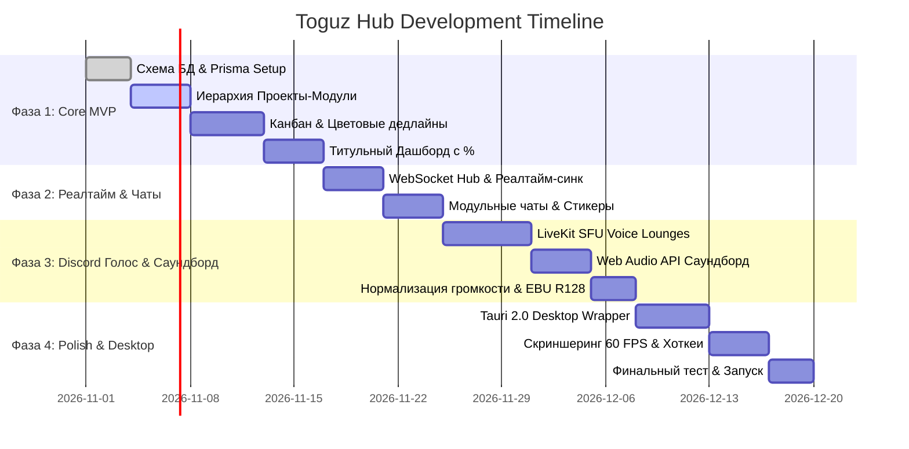

# 🚀 Дорожная карта реализации (Implementation Roadmap)

План пошагового создания платформы Toguz Hub, разбитый на четкие спринты.

---

## 📅 Фазы разработки

---

## Фаза 1: Core MVP — Проекты, Модули и Горящие дедлайны (Дни 1–14)
* **Цель**: Запустить работающий веб-интерфейс, где фаундер может создать проект, разбить его на модули, накидать задачи и видеть прогресс в %.
* **Ключевые результаты**:
  - [ ] Развернута база данных PostgreSQL и применены миграции Prisma (`schema.prisma`).
  - [ ] Реализован титульный экран [[01_Product_Requirements/03_Dashboard_&_Title_Page|Title Dashboard]]:
    - Список проектов.
    - Карточки модулей с круговыми SVG прогресс-барами (0–100%).
    - Баннер горящих дедлайнов (красный неоновый глоу для задач < 24ч).
  - [ ] Реализована Канбан-доска:
    - 4 колонки: `BACKLOG`, `IN_PROGRESS`, `REVIEW`, `DONE`.
    - Цветовая кодировка карточек по времени дедлайна.
    - Автоматический пересчет процента модуля при закрытии задач.

---

## Фаза 2: Реалтайм-синхронизация и Модульные чаты (Дни 15–22)
* **Цель**: Сделать взаимодействие команды живым и быстрым.
* **Ключевые результаты**:
  - [ ] WebSocket-шлюз на Socket.io/Redis: мгновенный синк перемещения карточек между браузерами.
  - [ ] Текстовые каналы, привязанные к модулям (`#mod-auth`, `#mod-webrtc`).
  - [ ] Markdown-редактор, сниппеты кода, инлайн-упоминания задач (`#TASK-42`).
  - [ ] Кастомные паки стикеров и реакции на сообщения.

---

## Фаза 3: Discord Voice Lounges и Саундборд (Дни 23–35)
* **Цель**: Добавить Discord-энергию, голос и веселье.
* **Ключевые результаты**:
  - [ ] Развернут LiveKit SFU медиа-сервер.
  - [ ] Голосовые комнаты с мгновенным входом в 1 клик (без ссылок на зум).
  - [ ] Индикация говорящего (зеленый ореол вокруг аватарки).
  - [ ] Саундборд:
    - Web Audio API плеер на клиенте с лимитером `-14 dBFS`.
    - Сетка кнопок со звуками мемов и хоткеями `[1]` .. `[9]`.
    - WebSocket-бродкаст звуковых триггеров на всех участников комнаты.
    - Защита от спама (кулдаун 3 секунды).

---

## Фаза 4: Desktop-клиент, Скриншеринг и Полировка (Дни 36–45)
* **Цель**: Нативное ощущение от приложения и 60 FPS производительность.
* **Ключевые результаты**:
  - [ ] Сборка легкого десктопного приложения на **Tauri 2.0** (Windows & macOS).
  - [ ] Глобальные горячие клавиши (Mute микрофона `Ctrl+Shift+M` даже при свернутом окне).
  - [ ] Демонстрация экрана в 1080p 60 FPS для парного кодинга.
  - [ ] Звуковой дизайн: тактильные клики при создании и закрытии задач.

---

Смотрите далее:
- [[Master_AI_Guidelines|Главное руководство для ИИ]]
- [[AI_Prompt_Playbook|Сборник готовых промптов]]
- [[00_Start_Here/Index|Главная карта знаний]]
