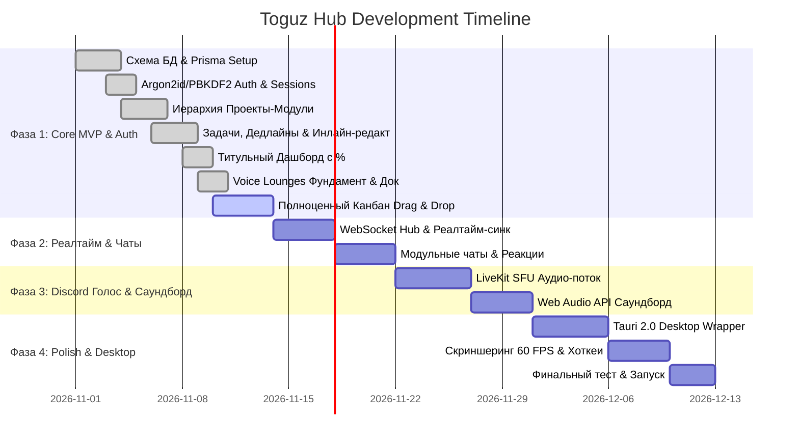

# 🚀 Дорожная карта реализации (Implementation Roadmap)

План пошагового создания платформы Toguz Hub, разбитый на четкие спринты.

---

## 📅 Фазы разработки

> 📢 **Инструкция для новых разработчиков**: Перейдите в [[Team_Handover_&_Next_Tasks|Руководство по передаче проекта и задачи для команды]].

---

## Фаза 1: Core MVP — Проекты, Модули и Горящие дедлайны
* **Цель**: Запустить работающий веб-интерфейс, где фаундер может создать проект, разбить его на модули, накидать задачи и видеть прогресс в %.
* **Ключевые результаты**:
  - [x] Развернута база данных PostgreSQL и применены миграции Prisma (`schema.prisma`).
  - [x] Полноценная безопасная аутентификация (Argon2id/PBKDF2, сессионные куки, защита от брутфорса).
  - [x] Реализован титульный экран [[01_Product_Requirements/03_Dashboard_&_Title_Page|Title Dashboard]]:
    - [x] Список проектов с созданием и каскадным удалением.
    - [x] Карточки модулей с круговыми SVG прогресс-барами (0–100%) и созданием модулей.
    - [x] Баннер горящих дедлайнов (красный неоновый глоу для задач < 24ч).
  - [x] Интерактивное управление задачами:
    - [x] Создание и удаление задач с авто-пересчетом прогресса модулей и проекта.
    - [x] Инлайн-переименование названия задачи в 1 клик (Enter/Blur to save).
    - [x] Модальное окно `✎` с быстрыми пресетами дедлайнов (8h, 2d, 1w), выбором стадии, модуля и приоритета.
  - [x] Голосовые комнаты (Фундамент):
    - [x] Хранение Voice Lounges в PostgreSQL.
    - [x] Вход в 1 клик и мгновенное переключение комнат.
    - [x] Звуковые эффекты на Web Audio API (вход, выход, мут).
    - [x] Персистентный плавающий Audio Dock внизу экрана с хоткеями `Ctrl+Shift+M` и `Ctrl+Shift+D`.
    - [x] Модалка создания новых комнат.
  - [ ] Реализация полноценной Канбан-доски:
    - [ ] 4 колонки: `BACKLOG`, `IN_PROGRESS`, `REVIEW`, `DONE`.
    - [ ] Drag-and-Drop карточек с оптимистичным обновлением.
    - [ ] Автоматический пересчет процента модуля при закрытии задач.

---

## Фаза 2: Реалтайм-синхронизация и Модульные чаты
* **Цель**: Сделать взаимодействие команды живым и быстрым.
* **Ключевые результаты**:
  - [ ] WebSocket-шлюз на Socket.io/Redis: мгновенный синк перемещения карточек между браузерами.
  - [ ] Текстовые каналы, привязанные к модулям (`#mod-auth`, `#mod-webrtc`).
  - [ ] Markdown-редактор, сниппеты кода, инлайн-упоминания задач (`#TASK-42`).
  - [ ] Кастомные паки стикеров и реакции на сообщения.

---

## Фаза 3: Discord Voice Lounges и Саундборд
* **Цель**: Добавить Discord-энергию, голос и веселье.
* **Ключевые результаты**:
  - [x] Архитектурный фундамент, хранение комнат, Web Audio API звуки и Audio Dock.
  - [ ] Подключение реального WebRTC медиа-потока через LiveKit SFU сервер.
  - [ ] Индикация говорящего (VAD) в реальном звуковом потоке.
  - [ ] Саундборд:
    - [ ] Web Audio API плеер на клиенте с лимитером `-14 dBFS`.
    - [ ] Сетка кнопок со звуками мемов и хоткеями `[1]` .. `[9]`.
    - [ ] WebSocket-бродкаст звуковых триггеров на всех участников комнаты.
    - [ ] Защита от спама (кулдаун 3 секунды).

---

## Фаза 4: Desktop-клиент, Скриншеринг и Полировка
* **Цель**: Нативное ощущение от приложения и 60 FPS производительность.
* **Ключевые результаты**:
  - [ ] Сборка легкого десктопного приложения на **Tauri 2.0** (Windows & macOS).
  - [ ] Глобальные горячие клавиши (Mute микрофона `Ctrl+Shift+M` даже при свернутом окне).
  - [ ] Демонстрация экрана в 1080p 60 FPS для парного кодинга.
  - [ ] Звуковой дизайн: тактильные клики при создании и закрытии задач.
  - [ ] Глобальные горячие клавиши (Mute микрофона `Ctrl+Shift+M` даже при свернутом окне).
  - [ ] Демонстрация экрана в 1080p 60 FPS для парного кодинга.
  - [ ] Звуковой дизайн: тактильные клики при создании и закрытии задач.

---

Смотрите далее:
- [[Master_AI_Guidelines|Главное руководство для ИИ]]
- [[AI_Prompt_Playbook|Сборник готовых промптов]]
- [[00_Start_Here/Index|Главная карта знаний]]
